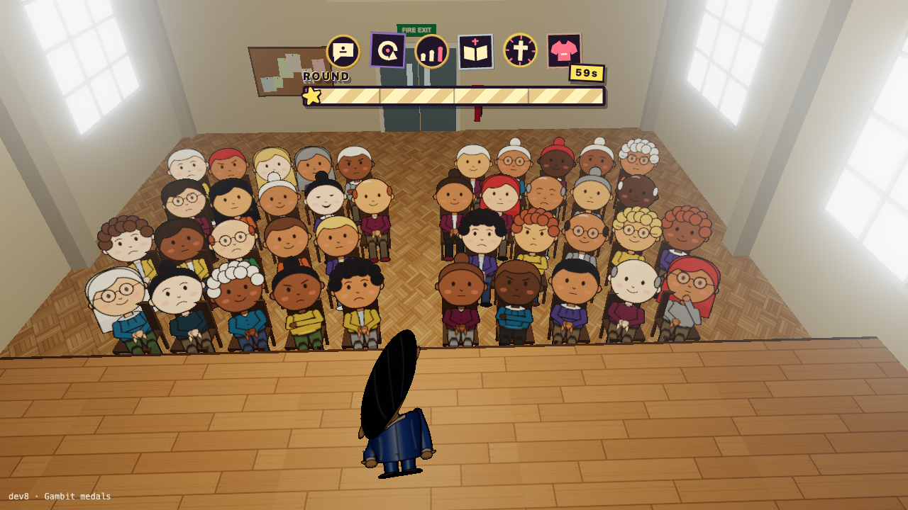

# Gambits, power-ups and equipment

What the Speaker uses to engage the audience. Every item has **upsides and downsides**, often a chance of something going wrong. See issue [#5](https://github.com/DanChambersAnimation/shrew_farmer/issues/5) for the shared effect system, [#3](https://github.com/DanChambersAnimation/shrew_farmer/issues/3) for crowd responses, and [#2](https://github.com/DanChambersAnimation/shrew_farmer/issues/2) for the icon row.

**Status:** the registry and effect pipeline exist (`src/gambits/`, from #8). The five conversational gambits and the T-shirt cannon below have simulation rules and 3D medals built by `src/prefabs/gambit-medal.ts`. The clickable rack above the timer draws five gambits per round in dev3; dev8 shows all six. Other equipment and power-ups below remain design ideas.



**How an item is defined** (`src/gambits/effect.ts`): an item is a list of **weighted outcomes**. Each outcome has a **target** (the whole audience, the room, or a neighbourhood within a radius) and **effects**. An effect changes a person's approval and/or engagement, can decide whether it reaches them at all (e.g. too bored to notice), and can scale by context (personality, what they remember, the round time). Risky items are just extra outcomes with low weights.

Each item attaches named traits from `src/gambits/traits.ts`. **Cooldown** gates repeat use and drives a clock-face sweep on the medal. **LimitedUse** removes the item after its final use; the medal burns away and a fresh gambit can materialise in its place. **BuildUp** releases the crowd effect after several accepted uses. The traits are independent, so an item can combine them.

## Entry template

```md
### Name

- **Kind:** conversational gambit / power-up / equipment
- **Upside:** what it does when it works
- **Risk:** what can go wrong, and roughly how likely
- **Combines with:** other items, traits or room features it interacts with
- **Notes / issue:**
```

## Conversational gambits

### Personal anecdote

- **Kind:** conversational gambit
- **Upside:** raises engagement; attentive listeners remember the story.
- **Risk:** inattentive listeners miss it, so later callbacks fall flat for them.
- **Combines with:** callback.
- **Uses:** repeatable after a 15-second cooldown.
- **Notes / issue:** from #3. **Built** (`src/gambits/items/anecdote.ts`).

### Callback to anecdote

- **Kind:** conversational gambit
- **Upside:** strong with listeners who heard the anecdote.
- **Risk:** weak or awkward for anyone who didn't.
- **Combines with:** personal anecdote (needs audience memory).
- **Notes / issue:** from #3. **Built**: lands best about 15 s after the anecdote; too soon is flat, never having heard it is awkward.

### Rule of three

- **Kind:** conversational gambit
- **Upside:** a modest, rhythmic engagement boost.
- **Risk:** —
- **Notes / issue:** from #3. **Built** with a modest engagement lift for attentive listeners, shaped by intelligence. Each accepted use lights another mark on its medal and plays a note one whole tone higher. A future visual effect could drive colour-chase lighting in time with the three beats.
- **Uses:** three beats; the crowd effect fires on the third, then the medal burns away.

### Pious statement

- **Kind:** conversational gambit
- **Upside:** raises approval among listeners with faith affinity.
- **Risk:** lowers it among those without.
- **Notes / issue:** from #3. **Built**: approval shifts with faith affinity, independently of superstition.
- **Uses:** unlimited, with a 12-second cooldown.

### "Praise Jesus!"

- **Kind:** conversational gambit
- **Upside:** a strong faith appeal; big approval from faith-positive listeners.
- **Risk:** faith-negative listeners react just as strongly the other way.
- **Notes / issue:** from #3. **Built**: a stronger faith-affinity response than the pious statement.

### T-shirt cannon

- **Kind:** spectacle gambit
- **Upside:** three distinct, randomly selected audience members receive shirts. Already engaged people gain approval and engagement.
- **Risk:** a hit on a disengaged person has a 35% chance of injury, setting them to furious disapproval and full engagement.
- **Visual and audio:** three shirt-shaped projectiles arc from the Speaker to the selected people, each accompanied by a synthesized “whomp”.
- **Uses:** once per round.
- **Notes / issue:** built with the shared random-target resolver and effect registry.
- **Preview:** open `?room=dev7` for a fixed cannon hand, then click its medal.

## Equipment and power-ups

### Flashpot

- **Kind:** equipment
- **Upside:** a big, crowd-pleasing burst of light and smoke.
- **Risk:** a small chance of setting the stage on fire.
- **Combines with:** candles, smoke alarm and sprinklers (room hazards).
- **Notes / issue:** #5.

### Laser wheel

- **Kind:** equipment (a fictional high-tech device, possibly ex-military)
- **Upside:** dazzles the audience.
- **Risk:** may activate a sleeper-agent assassin in the crowd; could dazzle someone.
- **Combines with:** a smoke or haze machine, which makes the beams visible.
- **Notes / issue:** #5. The sleeper agent is an ordinary audience member with a hidden, dormant trait.

### Lighting and spectacle (candidates)

Ideas for lighting-based items, each needing an upside and a risk:

- **Blackout:** a dramatic pause before a big line. Risk: restlessness; someone sneaks out.
- **Audience light-up:** light the crowd for participation. Risk: people hate being singled out.
- **Follow spot:** track the Speaker, or pick out one audience member.
- **Strobe:** big energy. Risk: elderly audience members faint. Needs a photosensitivity setting for players.
- **Disco ball:** moving flecks of light over the room.
- **Pyro fountains:** a shower of sparks. Risk: smoke alarm and sprinklers.
- **Indoor fireworks:** an obviously terrible idea. Risk: ceiling fire, panic, a stray rocket.
- **Confetti cannon:** cheap and cheerful. Risk: the vicar is furious about the cleanup.
- **Smoke / haze machine:** atmosphere; makes lasers and spots visible. Risk: coughing, smoke alarm.
